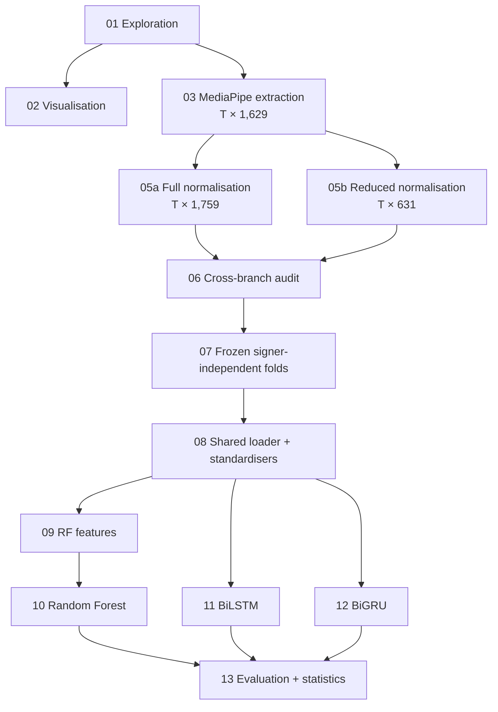

# Signer-Independent Bangla Sign Language Word Recognition

**A Full-versus-Reduced MediaPipe Landmark Benchmark Across Random Forest, BiLSTM, and BiGRU**

B.Sc. thesis, Department of Computer Science and Engineering, Metropolitan University, Sylhet (October 2026)

**Authors:** Shahriar Hasan · Md. Tanimur Rahman
**Supervisor:** Aisha Haider Chowdhury · **Co-supervisor:** Nabila Jannat Rifa

---

## Overview

MediaPipe Holistic landmarks are a compact, background-robust alternative to raw RGB video for sign language recognition. In the standard holistic layout, though, the 468-point face mesh takes up **1,404 of 1,759** per-frame features. Nobody had tested whether that facial detail helps recognise **signers the model has never seen**. Evaluation that lets signers overlap between training and test sets can hide the answer, because models can rely on signer-specific cues.

This repository holds the full experimental pipeline (13 notebooks) that compares two representations of the **SignBD-Word** corpus (6,000 clips, 200 words, 16 signers):

| | face landmarks | features / frame | non-face part |
|---|---|---|---|
| **Full** | 468 (whole mesh) | 1,759 | identical 355 columns |
| **Reduced** | 92 (lips, eyes, eyebrows) | 631 | identical 355 columns |

Only the face block changes. Pose, both hands (global and wrist-local) and the presence masks stay identical, and this is verified byte for byte. Both representations are evaluated with **Random Forest, BiLSTM and BiGRU** under **8 rotating signer-held-out folds**, in which every signer is an unseen test signer exactly once.

**Main finding.** Reduced was **more accurate in every fold and for every signer, across all three model families** (+6.40 / +6.04 / +3.86 pp, Holm-adjusted p = 0.023), and it trained up to **43.7% faster**. More facial landmarks did not mean better generalisation to new signers.

## Research gap

Prior work shows that landmark-based BdSL recognition is viable and that signer-independent evaluation matters. It still leaves three questions unanswered under one controlled protocol:

1. **No clean unseen-signer benchmark.** BdSL results are often reported on splits where the same signers appear in training and test. There is no clear benchmark of RF, BiLSTM and BiGRU in which test signers are excluded from training *and* from learned preprocessing such as standardisers and feature filters. → **RQ1**
2. **The role of facial width is untested.** The face mesh supplies 80% of holistic features (1,404 / 1,759), yet nobody has tested whether that detail helps or hurts on new signers while pose, hands, masks, splits and evaluation are held constant. → **RQ2**
3. **Aggregates hide per-person behaviour.** A pooled gain does not show whether a representation helps *every* unseen person, which matters for a system that has to serve people absent from training. → **RQ3**

**Positioning.** This thesis fills that narrow gap with a controlled Full-versus-Reduced benchmark across three model families. It does **not** claim that 92 landmarks are optimal, that signer identity is removed from the features, or that the model ranking is a statistically controlled architecture comparison.

## Research questions

| | question | answered in |
|---|---|---|
| **RQ1** (primary) | What signer-independent accuracy do RF, BiLSTM and BiGRU reach on unseen signers? | 10–13 |
| **RQ2** | How does Reduced (631) compare with Full (1,759) within each model family? | 13 |
| **RQ3** | Is the Full → Reduced difference consistent across folds and individual signers? | 13 |
| supporting | paired fold-level inference · signer-overlap control · training time and parameters | 07, 13 |

## Key results

Pooled out-of-fold (OOF) results over all 6,000 clips. Every prediction comes from a model that never saw that clip's signer.

| Metric (%) | RF Full | RF Reduced | BiLSTM Full | BiLSTM Reduced | BiGRU Full | **BiGRU Reduced** |
|---|---|---|---|---|---|---|
| Accuracy | 60.20 | 66.60 | 67.78 | 73.90 | 73.97 | **77.82** |
| Macro-F1 | 58.80 | 65.57 | 67.90 | 73.83 | 74.03 | **77.95** |
| Top-5 accuracy | 86.08 | 89.48 | 89.82 | 92.53 | 92.15 | **93.70** |
| Signer-macro accuracy | 59.97 | 66.19 | 67.73 | 73.98 | 73.89 | **77.89** |
| Fold mean ± SD | 60.46 ± 3.94 | 66.85 ± 4.08 | 68.15 ± 4.69 | 74.19 ± 4.94 | 74.26 ± 5.05 | 78.11 ± 4.46 |
| Parameters | 300 trees | 300 trees | 3,285,704 | 2,996,936 | 2,628,296 | 2,339,528 |

**Reduced − Full (RQ2/RQ3)**

| Model | mean fold Δ (pp) | 95% fold bootstrap CI | fold wins | signer wins | sign-flip p | Holm p |
|---|---|---|---|---|---|---|
| Random Forest | +6.40 | +5.73 to +7.29 | 8/8 | 16/16 | 0.0078 | 0.023 |
| BiLSTM | +6.04 | +5.10 to +6.98 | 8/8 | 16/16 | 0.0078 | 0.023 |
| BiGRU | +3.86 | +3.24 to +4.45 | 8/8 | 16/16 | 0.0078 | 0.023 |

With 8 folds the exact sign-flip p has a floor of 2/256, so effect sizes and intervals are the headline and p-values support them.

**Signer-overlap control.** A random class-stratified split that lets signers overlap inflates accuracy by **+4.20 to +13.17 pp** (BiGRU Reduced reaches 89.87% vs 77.82%). Reporting only overlapping evaluation would overstate performance on new users.

**Training time (8 primary folds, Full → Reduced).** RF 37.4 → 34.8 min (−7.0%), BiLSTM 89.9 → 59.2 min (−34.1%), BiGRU 89.2 → 50.2 min (−43.7%).

**Signer variation remains large.** Under BiGRU Reduced, per-signer accuracy ranges from 67.75% (p8) to 88.50% (p6).

## Dataset

**SignBD-Word** [1, 2]: 6,000 RGB videos, 200 Bangla words × 30 clips, 16 signers (p1–p16; p2 and p3 contribute 200 clips each and the others 400, but every signer covers all 200 words). Clips run 0.66–6.8 s (mean 2.80 s). Frame rates fall in two regimes, ~30 fps (2,365 clips) and ~60 fps (3,635), and the regime tracks the signer.

The videos and all derived landmark arrays are **not** redistributed here. Download the dataset from Zenodo ([doi:10.5281/zenodo.6779843](https://doi.org/10.5281/zenodo.6779843)) under its original terms.

## Pipeline

| # | Notebook | Purpose | Runtime |
|---|---|---|---|
| 01 | [01_dataset_exploration](01_dataset_exploration.ipynb) | Inventory clips, classes and signers; profile FPS, duration and resolution | CPU |
| 02 | [02_dataset_visualisation](02_dataset_visualisation.ipynb) | Qualitative inspection: sample frames, motion, lighting, resolution | CPU |
| 03 | [03_landmark_extraction](03_landmark_extraction.ipynb) | MediaPipe Holistic → `(T, 1629)` float32 per clip; resumable | CPU, ~8 h |
| 05a | [05a_normalisation_full](05a_normalisation_full.ipynb) | Shoulder-centred normalisation, local hands, gap filling, masks → 1,759 | CPU |
| 05b | [05b_normalisation_reduced](05b_normalisation_reduced.ipynb) | Same code, 92 face landmarks → 631 | CPU |
| 06 | [06_post_normalisation_audit](06_post_normalisation_audit.ipynb) | Quality gate: branches identical except the face; per-signer statistics | CPU |
| 07 | [07_signer_independent_folds](07_signer_independent_folds.ipynb) | 8 frozen 12/2/2 signer folds plus one overlap control | CPU |
| 08 | [08_shared_sequence_loader](08_shared_sequence_loader.ipynb) | Hash-verified loader, length cap, training-only standardisers | CPU |
| 09 | [09_rf_feature_engineering](09_rf_feature_engineering.ipynb) | Fixed-length physical-time features (25,168 / 9,000) | CPU |
| 10 | [10_random_forest](10_random_forest.ipynb) | RF, 16 primary + 2 control scopes | CPU |
| 11 | [11_bilstm](11_bilstm.ipynb) | BiLSTM, 16 + 2 scopes | GPU (T4) |
| 12 | [12_bigru](12_bigru.ipynb) | BiGRU: a controlled clone of 11 that changes only the cell type | GPU (T4) |
| 13 | [13_evaluation](13_evaluation.ipynb) | Recompute all metrics, signer-independence audit, paired inference | CPU |

Each notebook opens with a short note covering its goal, approach, design decisions, and inputs → outputs.

## Method highlights

**Landmark extraction (03).** MediaPipe Holistic 0.10.14 (`model_complexity=1`, smoothing on, refined face off, confidence 0.5). Frame layout: face `[0:1404]`, pose `[1404:1503]`, left hand `[1503:1566]`, right hand `[1566:1629]`. Pose is detected in 100% of frames and face in 99.5%, but the left hand only in 78.3% and the right hand in 87.6%, so explicit presence masks are kept.

**Normalisation (05a/05b), per clip.** Origin = shoulder midpoint, scale = shoulder width (5-frame smoothing). Each hand also gets a wrist-centred, hand-size-scaled copy. Gaps are linearly interpolated, and four binary masks record what was *actually* detected. Nothing is fitted across clips, so this stage cannot leak information between signers.

**Reduced face subset.** The 92 indices are exactly the unique endpoints of MediaPipe's lips, eye and eyebrow connection sets. The subset is fixed, author-defined and set before any model was run. It is not learned and not claimed to be optimal. It was chosen on the *assumption* that these regions carry the facial information relevant to signing. That assumption was not grounded in sign-language literature or expert input (see [Reflections](#reflections-after-the-thesis-defence)).

**Fold design (07).** Folds use 12 train / 2 validation / 2 test signers, rotating so that each signer is tested once and validated once. Signer pairs are chosen by **exact bitmask DP** so the 8 test sets are as alike as possible in sequence length and hand-tracking quality, which keeps fold variance about the representation question rather than about unlucky pairings. Signers p2 and p3 are never paired. Fold assignments:

| fold | test | validation | fold | test | validation |
|---|---|---|---|---|---|
| 0 | p1, p6 | p2, p7 | 4 | p5, p10 | p8, p16 |
| 1 | p2, p7 | p4, p12 | 5 | p8, p16 | p9, p15 |
| 2 | p4, p12 | p3, p14 | 6 | p9, p15 | p11, p13 |
| 3 | p3, p14 | p5, p10 | 7 | p11, p13 | p1, p6 |

**Leakage controls.**
- Standardisers are summed from per-signer sufficient statistics over the **12 training signers only**.
- RF zero-variance filters are fitted on training rows only.
- Presence masks are never z-scored.
- Shared modules are SHA-256-hashed before import.
- Every stage verifies the frozen upstream IDs and refuses to run against anything else.

**Models.**
- *RF (10):* 300 trees, `max_features=96` (held equal across branches, which is conservative toward Full), trained on the 12 training signers.
- *BiLSTM (11) / BiGRU (12):* `Linear(D→256)+LayerNorm+ReLU` → packed 2-layer bidirectional RNN (256 per direction) → masked mean ⊕ max pooling → `Linear(1024→200)`. Training uses AdamW and label smoothing, and early stopping on validation macro-F1 (≤ 60 epochs).
- *Shared rules:* no hyperparameter tuning, test signers predicted once per scope, and the recurrent core and head initialised bit-identically in both branches.

**Statistics (13).** Exact two-sided paired sign-flip test over all 256 assignments of the 8 fold differences, Holm correction across the 3 model families, and a fold-clustered bootstrap (10,000 resamples, seed 45000). No cross-model significance test was run, because RF and the RNNs differ in both architecture and time base.

## Reproducing

All notebooks were run on **Kaggle**, with internet off except for 03. Each notebook takes the *outputs* of earlier notebooks as attached inputs (see the "Inputs → Outputs" line at its top). Run them in numeric order. 05a and 05b are independent and can run in parallel, and so can 10, 11 and 12.

- **Software:** Python 3, MediaPipe 0.10.14, OpenCV, NumPy, pandas, scikit-learn, PyTorch (CUDA), matplotlib, tqdm.
- **Hardware:** CPU for everything except 11 and 12, which need a GPU. A T4 was used; the P100 is unsupported by the CUDA 12.8 PyTorch build.
- **Paths** point to `/kaggle/input/...` and `/kaggle/working/...`. Adjust the configuration cell at the top of each notebook to run elsewhere.
- **Determinism:** fixed seeds per stage (RF 42000+k, BiLSTM 43000+k, BiGRU 44000+k, bootstrap 45000), deterministic folds and loading, and deterministic cuDNN where supported.

**Frozen identifiers** (each stage checks these before running):

| stage | id |
|---|---|
| experiment | `1308155924042fc2` |
| loader contract | `112c4e5a438540d0` |
| standardiser set | `0cf4c790ec474110` |
| time metadata (FPS) | `e30a51110d2f9324` |
| RF feature contract / filter set | `bfcce8a5fa013fab` / `3b5f7a8bfc08656c` |
| RF / BiLSTM / BiGRU model contracts | `fc10c99099c63934` / `95d9c6457ab2ab14` / `cc4595f6f33e0658` |
| final analysis (148/148 checks passed) | `607af706edc1ad2b` |

## Limitations

The study is a controlled internal comparison on one 200-word landmark benchmark. It is not a deployment-ready BdSL translator. The limitations below define how far the results can be pushed.

**Dataset and population**
- **Few signers.** 16 signers cannot represent regional, demographic, proficiency or style variation in BdSL. Signer support is unequal: p2 and p3 have 200 clips each, the others 400.
- **Controlled recordings.** The clips are controlled isolated-word recordings, mostly at 1920×1080, and every signer covers every class. Results may not transfer to phone cameras, clutter, occlusion, low light, other viewpoints or spontaneous signing.
- **Single dataset.** No external dataset was tested. The evidence is dataset-specific signer-held-out performance, not cross-domain generalisation.

**Evaluation protocol and statistics**
- **Folds are not independent.** The design gives 8 signer-*pair* effects, not 16 per-signer effects, and consecutive folds share 10 of 12 training signers.
- **Approximate inference.** The sign-flip test relies on an approximate exchangeability argument and has coarse resolution (minimum p = 2/256). The bootstrap resamples only 8 clusters, so its intervals are sensitivity checks rather than precise population estimates.
- **Diagnostic control only.** The signer-overlap control is a single random split with different train/test sizes from the main protocol. It shows that overlap inflates scores but cannot isolate identity memorisation or measure an unbiased "signer penalty".

**Extraction and preprocessing**
- **Tracking errors propagate.** MediaPipe errors carry into every representation. Hands are often missing, and 700 clips have no left hand at all.
- **Unbounded gap filling.** Interpolation fills gaps of any length, which can create smooth but unobserved trajectories. The masks record the original detection but not *how* a value was filled (internal interpolation, endpoint hold or permanent zero), and global and local hands treat missing frames differently.
- **Extraction provenance not proven.** 5,306 of the 6,000 arrays were reused from an earlier run without binding them to an extractor config or video hash, and only 25 were re-sampled.
- **Approximate centring.** The 5-frame smoothing means coordinates are not exactly centred on the current shoulder midpoint (diagnostic residual 0.311). Normalisation reduces geometry differences but is not shown to remove person-specific geometry.
- **No common time base.** Clips run at 26–60 fps. RF uses clip-level FPS scaling, while the RNNs consume native frame indices, so some signer or recording variation may be entangled with frame rate.

**Representation and model confounding**
- **Subset not grounded.** The Reduced subset (lips, eyes, eyebrows) was taken from MediaPipe's own landmark groupings and assumed to capture the facial cues relevant to BdSL. No sign-language linguistics, prior SLR study or BdSL signer was consulted to justify which facial regions matter.
- **One subset tested.** Only one 92-landmark subset was evaluated: no other sizes, random 92-point subsets, region ablations or learned bottlenecks. Whether 92 is optimal, or which facial regions matter, remains open.
- **Not capacity-matched.** Full has 288,768 more projection parameters in the RNNs and ~2.81× more retained RF features with `max_features` fixed at 96. Facial *content* cannot be separated from dimensionality and capacity, so no content-only causal claim is made.
- **Different inputs across families.** RF sees engineered physical-time summaries while the RNNs see frame sequences, and BiLSTM and BiGRU differ in parameter count and seeds. With one stochastic run per scope and no guaranteed bit-determinism in cuDNN, cross-model ranking is descriptive.

**Training and compute measurement**
- **Convergence not guaranteed.** Five scopes hit the 60-epoch ceiling (BiLSTM Reduced folds 1 and 5; BiGRU Full folds 3, 4 and 7). There was no hyperparameter search, no multi-seed runs and no equal-compute budgets.
- **Partial timings.** Times are rounded fold-training minutes that exclude preprocessing, caching, inference and controls. RF ran on CPU and the RNNs on a T4, so speed-ups are within-family only. Peak memory and latency were not systematically measured.
- **Pre-declared but not run:** the RF `max_features="sqrt"` sensitivity analysis and the neural common-time (FPS) sensitivity analysis.

**Artefacts and reproducibility**
- Videos, landmark arrays, feature matrices, predictions, standardisers, training histories and model weights are not distributed. Rerunning the chain requires the dataset and full re-execution.

**Task and deployment**
- **Narrow task.** The models classify pre-segmented isolated words from a closed 200-word vocabulary. They do no sign spotting, coarticulation, sentence translation, grammar or rejection of unknown signs.
- **No real-world evaluation.** End-to-end live-camera latency, usability, cultural appropriateness and accessibility benefit were not evaluated with Deaf or signing communities.
- **Signer information remains.** Signer-independent evaluation means the model never saw the test signer. It does **not** mean the features are free of signer information; the overlap control shows such cues exist.

## Future work

From thesis Chapter 7:
1. Test on more signers and recording domains, including cross-dataset evaluation.
2. Identify *why* facial reduction helps, using region ablations, random subsets, matched-capacity bottlenecks and dimensionality sweeps.
3. Improve tracking and temporal normalisation with gap-aware masks and common-time resampling.
4. Broaden the model comparison to graph networks and Transformers with multiple seeds and tuning budgets.
5. Strengthen the statistics with repeated grouped splits and hierarchical models.
6. Move towards continuous, real-time BdSL with community-centred evaluation.

## Reflections after the thesis defence

*A personal note, written after the thesis was examined and graded.*

After the defence I went back through the whole pipeline line by line, setting the report aside, to see how the work holds up from where I stand now. I did not continue the experiments, so nothing below has been re-run. These are the lessons I took away, including the main criticism raised by the defence board, and how I would design the study today. I am recording them because finding the weak points in my own work taught me more about research than getting the results did.

**What held up.** The core safeguards check out in the code:
- Test signers never reach any fitted object, whether standardiser, feature filter or model.
- Every out-of-fold prediction comes from a fold that held out that clip's signer.
- Full and Reduced differ only in the face block.
- Sequence packing and masked pooling are correct.
- The recurrent core and head really do start bit-identical in both branches.

**The first thing I would fix: ground the face subset before testing it.** *(Raised by the thesis defence board.)*
The Reduced representation keeps the lips, eyes and eyebrows and drops the rest of the face mesh. I took that choice from MediaPipe's own landmark groupings and *assumed* these were the facial regions that matter for signing. I did not cite sign-language linguistics or earlier recognition studies, and I did not ask a BdSL signer, interpreter or linguist. The board was right that a claim like this has to be established, not taken for granted. The whole Full-versus-Reduced comparison depends on the subset being meaningful. Without that grounding, the result shows that *this particular* subset worked better, not that it worked better *because* it keeps the linguistically relevant parts of the face.

If I did this again, before writing any code I would:
1. Review the sign-language linguistics literature on non-manual features (eyebrow movement, eye gaze, mouth shapes and mouthing, head movement), and in particular any work on BdSL.
2. Review how earlier landmark-based SLR studies chose or reduced facial landmarks, and why.
3. Consult Deaf BdSL signers or interpreters about which facial cues distinguish the words in the vocabulary.
4. Only then fix the subset, cite its justification, and test it against random and region-wise alternatives so the data can confirm or refute the assumption.

The broader lesson: when a design choice encodes a claim about the domain, the claim needs evidence or expert input *before* it becomes an experimental condition.

**Other things I would do differently**

| Area | What we did | What I learned | What I would do now |
|---|---|---|---|
| **Run-to-run variance** | One training run (one seed) per fold and branch | A paired fold difference mixes the representation effect with ordinary training randomness, and we never measured the second part. This matters most for the smaller BiGRU gap (+3.86 pp). | Several seeds per scope, with seed variance reported next to the effect |
| **Training budget** | Fixed 60-epoch ceiling. Some runs stopped *at* the ceiling: BiGRU Full in 3 folds, BiLSTM Reduced in 2 | A ceiling that hits one branch more than the other is not neutral. Under-trained BiGRU Full models could widen the BiGRU gap in Reduced's favour. Our check for this (`best_epoch < MAX_EPOCHS`) could never fail. | A budget large enough that early stopping always triggers, and an automatic flag on any run with `best_epoch ≥ MAX_EPOCHS − patience` |
| **Fair hyperparameters across inputs** | RF `max_features = 96` for both branches | Equal in absolute terms but not relative ones: ≈0.4% of Full's features vs ≈1.1% of Reduced's per split. Full's forests saw far fewer pose and hand candidates, so the RF gap mixes representation with search breadth. | Scale settings with input size (`sqrt` or an equal fraction) as the primary setting, or tune within the training signers |
| **Representation vs capacity** | Compared 468 vs 92 face landmarks | Reduced changes facial content, dimensionality and model size all at once, so the design shows *that* it helps but not *why*. | Add controls: random 92-landmark subsets, matched-dimension projections, region-by-region ablations |
| **Statistical inference** | Sign-flip test over 8 folds, Holm, fold bootstrap | Folds share 10 of 12 training signers, so they are not independent and the p-values are optimistic. When all 8 differences are positive, the bootstrap only restates the sign pattern. With 8 folds and no seed replicates, the uncertainty is underestimated. | Repeated grouped cross-validation with a variance correction for overlapping training sets (e.g. Nadeau–Bengio), or a mixed-effects model with signer and seed as random effects |
| **Geometry units** | Shoulder width measured in MediaPipe's image-normalised x and y | x is divided by frame width and y by height, so the two axes aren't in the same units unless the aspect ratio is fixed. Almost all clips are 1920×1080, so the effect is small, but it is a hidden dependence on the camera. Clips with no pose detected kept un-normalised coordinates without being flagged. | Convert to pixel units (or rescale by aspect ratio) before computing distances, and fail loudly on fallback cases |
| **Time base** | Frame-indexed smoothing, with RF velocity scaled by FPS | With 30 vs 60 fps tied to signer, the same 5-frame window covers a different span of time. Multiplying by FPS also amplifies landmark jitter in 60 fps clips. Both can let recording setup act as a hidden signer cue. | Resample every clip to one common frame rate at the start of the pipeline |
| **Missing data** | Absent frames stored as zeros; standardisation statistics computed over all frames | Zeros from missing hands pulled the means and variances by each signer's detection rate, and gaps of any length were interpolated. | Mask-aware statistics (observed frames only), a maximum interpolation gap, and a mask that records *how* each value was filled |
| **Efficiency measurement** | Total training time per fold | Total time mixes per-epoch cost with the number of epochs, and in RF the Full branch always ran first. | Report time per epoch, repeat timings, randomise run order, and measure peak memory per run |
| **Validation that can fail** | Many automated "PASS" checks | Some checks were literal `True` values, could never fail, or passed vacuously when an input file was missing. Some conclusions in the evaluation notebook were hard-coded text rather than computed from the data. | Every check needs a test that proves it can fail, and reported statements are generated from the numbers |
| **Order of experiments** | BiGRU designed after the BiLSTM test results were visible | Even with no settings changed, the second model was effectively a second look at the test data. | Freeze every model's specification before any test result is seen, and keep test metrics hidden until all models are trained |

**How I read our result now.** Reduced beating Full in every fold for all three model families is still a consistent pattern, and I believe the direction. What I would no longer do is put much weight on the *size* of the gaps, especially for BiGRU and RF, or present the p-values as strong evidence, until the seed variance, the epoch ceiling and the RF search breadth are controlled.

**What this taught me.** Making a pipeline reproducible is not the same as making the comparison fair. Hashes, frozen contracts and hundreds of passing checks made the work traceable, but they did not catch an unequal hyperparameter or an uneven training budget. That needs a different habit: deliberately asking how a design choice could favour one condition, and testing it. I now start a project by writing down what would make the comparison unfair, and I treat a check that cannot fail as no check at all.

## Repository notes

- **Outputs are stripped.** The notebooks contain code only. Executed results are reported in the thesis.
- **No notebook 04.** It was an earlier hand-only (126-feature) experiment and is not part of the final evaluation.
- Videos, landmark arrays, feature matrices, predictions and trained models are not included.
- The thesis PDF is not part of this repository.

## References

1. A. Sams, A. H. Akash, and S. M. M. Rahman, "SignBD-Word: Video-based Bangla word-level sign language and pose translation," *Proc. 14th ICCCNT*, Delhi, 2023, doi: [10.1109/ICCCNT56998.2023.10306914](https://doi.org/10.1109/ICCCNT56998.2023.10306914).
2. A. Sams, "SignBD-Word: Video-Based Bangla Word-Level Sign Language Dataset," Zenodo, v1, 2022, doi: [10.5281/zenodo.6779843](https://doi.org/10.5281/zenodo.6779843).
3. Google AI Edge, MediaPipe Holistic and Face Mesh (v0.10.14).

## Acknowledgements

We thank our supervisor Aisha Haider Chowdhury, co-supervisor Nabila Jannat Rifa, reviewers Md. Fahmidur Rahman Sakib and Abdul Wadud Shakib, and the creators of the SignBD-Word dataset.
